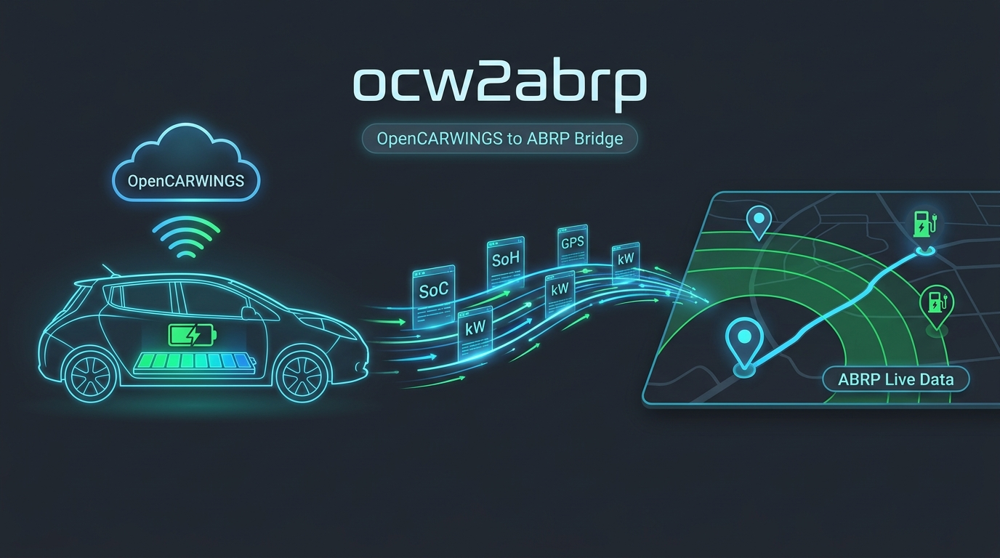

# ocw2abrp — OpenCARWINGS to ABRP Live Telemetry Bridge

<p align="center">
  
</p>

<p align="center">
  
  
  
  
</p>

**`ocw2abrp`** is a lightweight Python script that bridges **[OpenCARWINGS](https://opencarwings.viaaq.eu)** and **[A Better Routeplanner (ABRP)](https://abetterrouteplanner.com)**.

It continuously fetches live vehicle telemetry from your OpenCARWINGS-connected EV (such as a **Nissan LEAF** or **e-NV200**) and streams it to the ABRP Telemetry API, providing real-time State of Charge (SoC), State of Health (SoH), remaining energy (kWh), usable battery capacity, GPS coordinates, charging status, and temperatures for accurate route and range optimization.

---

## Features

- **Full Telemetry Mapping**: Feeds ABRP with battery SoC, SoH, remaining energy (`soe`), degraded usable capacity (`capacity`), GPS position (`lat`/`lon`), odometer, TPMS tire pressures, temperatures, and vehicle-estimated range.
- **Smart Power & Speed Estimation**: Detects AC charging power (`-1.2 kW`, `-3.6 kW`, `-6.6 kW`) immediately from CARWINGS charge time registers (`limit_chg_time`, `full_chg_time`, `obc_6kw`) and refines average power (`kW`) and speed (`km/h`) across consecutive snapshots while driving or charging.
- **Zero-Config Vehicle Discovery**: Automatically detects the first VIN on your OpenCARWINGS account if `OCW_VIN` is omitted.
- **Flexible Authentication**: Supports both OpenCARWINGS **Personal API Keys** (`Token`) and **Username/Password** (`JWT Bearer`) with automatic token refresh.
- **ABRP Telemetry API v1 & v2**: Supports the standard ABRP v1 endpoint (`/1/tlm/send`) as well as the newer v2 endpoint (`/2/app/tlm`).
- **Optional Active TCU Refresh**: Can optionally trigger an active TCU data refresh (`command_type=1`) at a safe configurable interval when the vehicle is driving or charging.

---

## Telemetry Parameters Sent to ABRP

The script reads `/api/car/{vin}/` (and `/api/car/{vin}/probe/trips`) from OpenCARWINGS and maps the fields to ABRP:

| ABRP Parameter | OpenCARWINGS Source | Description |
| :--- | :--- | :--- |
| `utc` | `ev_info.last_updated` | UTC Unix timestamp in seconds |
| `soc` | `ev_info.soc_display` / `soc` | Battery State of Charge (`%`, defaults to dashboard SoC as recommended by ABRP) |
| `soh` | `ev_info.soh` | Battery State of Health (`%`) |
| `soe` | `ev_info.wh_content` / `gids * 80 Wh` | Remaining energy in the battery (`kWh`) |
| `capacity` | `max_gids * (soh / 100) * 80 Wh` | Degraded usable battery capacity (`kWh`) |
| `lat`, `lon` | `location.lat`, `location.lon` | Current vehicle GPS coordinates |
| `is_charging` | `ev_info.charging` | `1` when charging, `0` otherwise |
| `is_dcfc` | `ev_info.quick_charging` | `1` when DC fast charging (CHAdeMO), `0` on AC |
| `is_parked` | `ev_info.car_running` / `car_gear` | `1` when parked (`P` or off), `0` when driving |
| `est_battery_range` | `ev_info.range_acon` / `range_acoff` | Vehicle's estimated range (`km`) based on A/C status |
| `odometer` | `odometer` / `veh_health.mileage` | Total vehicle mileage (`km`) |
| `tire_pressure_*` | `veh_health.tpms_*_float` | Front/Rear Left/Right tire pressures converted to `kPa` |
| `cabin_temp` | `ev_info.cabin_temp` | Interior cabin temperature (`°C`) |
| `ext_temp`, `batt_temp` | `probe/trips` (when recent) | Ambient and battery temperatures (`°C`) |
| `power` | `limit_chg_time` / `full_chg_time` / `obc_6kw` & `ΔWh/Δt` | Charging power (`-1.2` / `-3.6` / `-6.6 kW`) and measured power (`kW`, positive = driving, negative = charging) |
| `speed` | Computed across snapshots | Average speed (`km/h`) from GPS Haversine / odometer delta |
| `car_model` | `ABRP_CAR_MODEL` *(optional)* | ABRP vehicle typecode (e.g., `nissan:leaf:12:24:other`) |

---

## 1. Installation

1. Make sure **Python 3.9+** is installed on your machine.
2. Clone this repository and install the dependencies:

```bash
git clone https://github.com/drrcastro/ocw2abrp.git
cd ocw2abrp
pip install -r requirements.txt
```

---

## 2. Configuration

1. Copy `.env.example` to `.env`:

```bash
cp .env.example .env
# Or on Windows PowerShell:
Copy-Item .env.example .env
```

2. Open `.env` and fill in your credentials:
   - **`OCW_API_KEY`**: Your OpenCARWINGS Personal API Token (found in **Account Settings** on [opencarwings.viaaq.eu](https://opencarwings.viaaq.eu)). Alternatively, you can set `OCW_USERNAME` and `OCW_PASSWORD`.
   - **`ABRP_USER_TOKEN`**: Your vehicle's ABRP live telemetry token:
     1. Open the **ABRP** app or website ([abetterrouteplanner.com](https://abetterrouteplanner.com)).
     2. Go to **Car Settings** -> **Live Data** -> **Generic** (*Link Generic*).
     3. Copy the generated **User Token** and paste it into `ABRP_USER_TOKEN`.
   - **`OCW_VIN`** *(Optional)*: Leave empty to automatically select the first vehicle in your OpenCARWINGS account.
   - **`ABRP_CAR_MODEL`** *(Optional)*: Leave empty to use the vehicle model configured in your ABRP account, or set an explicit ABRP typecode (e.g., `nissan:leaf:12:24:other`).

> [!TIP]
> **In-Drive Updates in OpenCARWINGS:**
> In your vehicle settings on the OpenCARWINGS web portal, enable **Periodic Refresh (Running)** (e.g., every 5 minutes) so your car's TCU automatically pushes updated telemetry while you drive.

---

## 3. Usage

### Test without sending data to ABRP (Dry-Run Mode)
Verify your OpenCARWINGS connection and inspect the exact JSON payload that will be sent to ABRP:

```bash
python ocw2abrp.py --once --dry-run
```

### Send a single update and exit
```bash
python ocw2abrp.py --once
```

### Run continuously
```bash
python ocw2abrp.py
```

### Command-Line Options

| Flag | Description |
| :--- | :--- |
| `--vin <VIN>` | Specify the vehicle VIN (overrides `OCW_VIN` in `.env`) |
| `--interval <SEC>` | OpenCARWINGS polling interval in seconds (default: `30`) |
| `--heartbeat <SEC>` | Maximum interval between ABRP heartbeats when data hasn't changed (default: `300`) |
| `--once` | Run a single sync cycle and exit |
| `--dry-run` | Fetch from OpenCARWINGS and print the ABRP payload without sending |
| `--active-refresh` | Send an active TCU refresh command (`command_type=1`) while driving/charging |
| `--v2` | Use the ABRP Telemetry API v2 endpoint (`/2/app/tlm`) instead of v1 (`/1/tlm/send`) |
| `-v`, `--verbose` | Enable verbose debug logging |

---

## API References

- **OpenCARWINGS API Documentation**: [https://opencarwings.viaaq.eu/apidocs/](https://opencarwings.viaaq.eu/apidocs/) 
- **Iternio / ABRP Telemetry API (v1)**: [Postman Documentation](https://documenter.getpostman.com/view/7396339/SWTK5a8w)
- **Iternio Planning & Telemetry API (v2)**: [https://api.iternio.com/swagger-ui/#/](https://api.iternio.com/swagger-ui/#/) 
